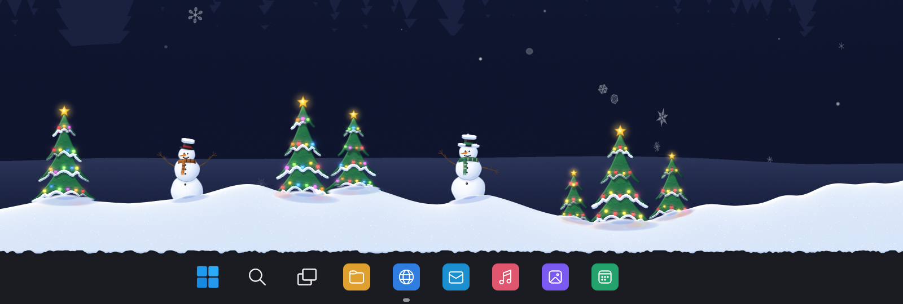
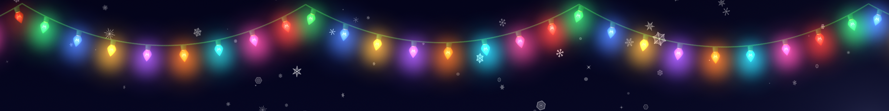
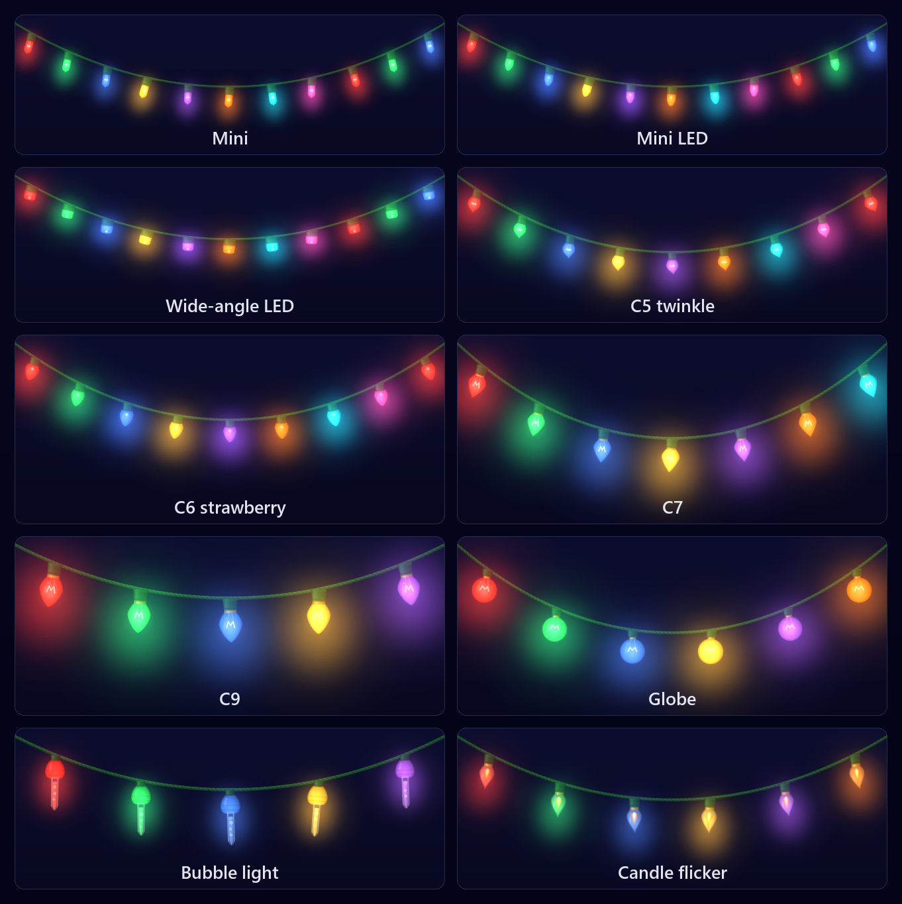
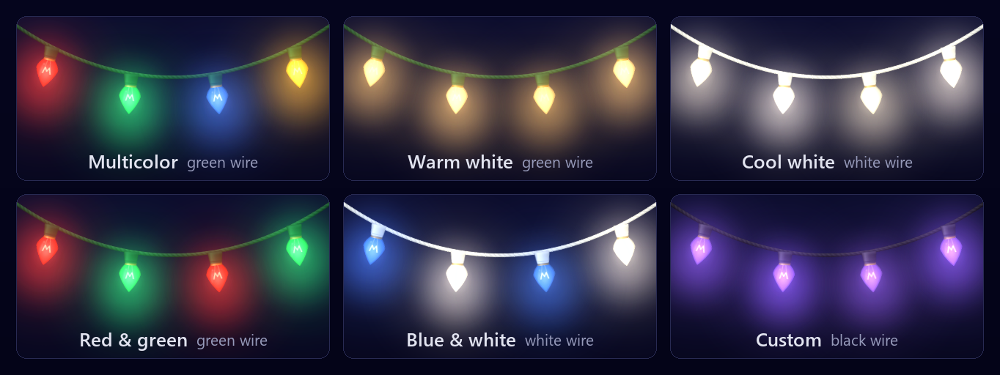
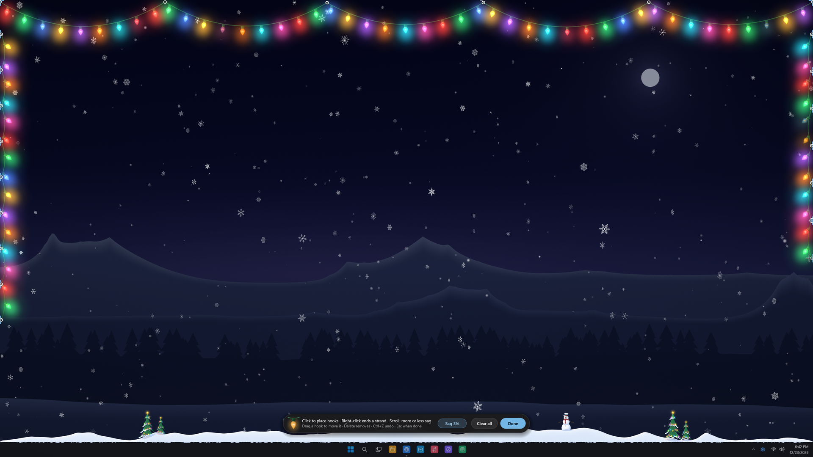
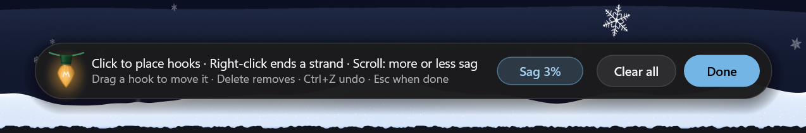
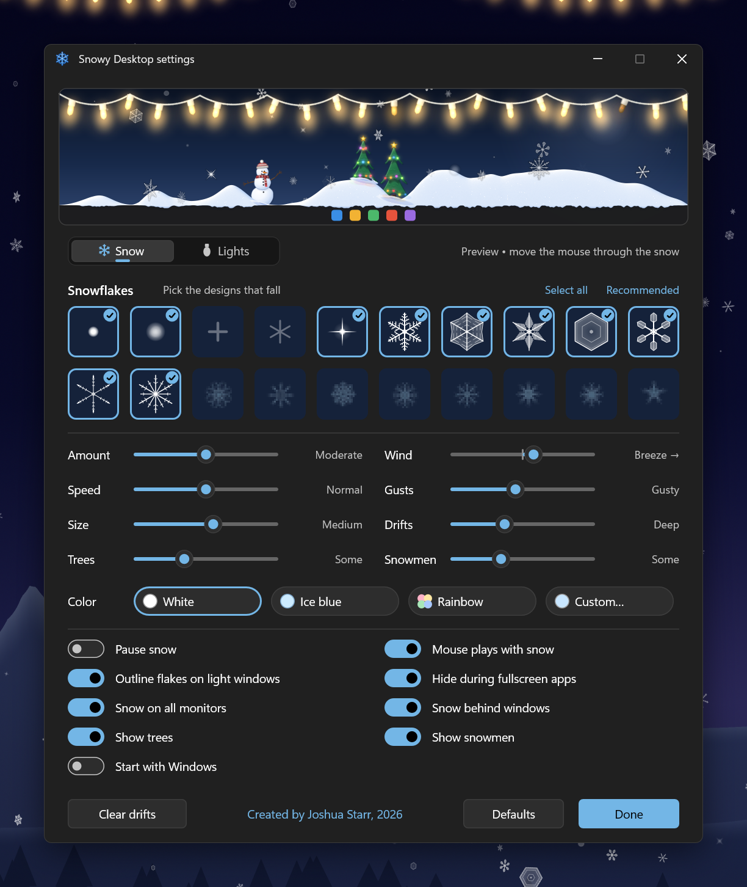

# Snowy Desktop

Snow and holiday lights for your Windows desktop. Flakes drift across every monitor,
sway in gusty wind, and gently pile up in haphazard drifts along the top of the
taskbar. Strings of holiday lights drape across the top of the screen, or hang
wherever you put them, glowing and swaying in the wind. Little holiday trees and
snowmen stand in the drifts, the trees' lights glowing too. You can sweep the snow
around and brush the lights with your mouse.


Snowy Desktop is a small native Windows 10/11 app written in C++ with Direct2D and
DirectComposition. It is a single ~1 MB `.exe` that lives in the notification
area, and clicks pass straight through the snow and the lights to whatever is
underneath.

## Snow drifts

Flakes that reach the taskbar settle into soft, rounded drifts: they build up,
slump when too steep, get sculpted by the wind, and slowly melt, so the pile keeps
changing shape. A little lip of snow hangs over the edge of the taskbar. Turn the
*Drifts* slider all the way up for snowbanks more than twice as deep as *Deep*.


## Holiday trees and snowmen

A few small holiday trees stand in the drifts on each monitor, always in the same
spots, with snowmen in the open stretches between them, turned towards the trees.



- The trees wear strings of softly glowing coloured lights; each group of trees runs
  its own slow pattern, and now and then a tree's golden star sparkles.
- Snow settles on the boughs, along their flat outer rims and on the bough tips. Heavy
  boughs sag under it and now and then drop a clump.
- The snowmen wear knitted scarves that flutter in the wind and top hats or bobble
  hats that gather snow.
- Brush the mouse through a tree to knock the snow off: the boughs sway and spring
  back up. Bump a snowman and it rocks, its hat wobbles and the snow on it flies off.
  Trees and snowmen always stay put.
- They stand on the snow and rise and settle as the drift around them changes.
- When the snow is drawn over windows, they step aside where a window covers them.
- How much snow the boughs and hats hold follows the *Drifts* slider; with drifts off
  the trees stay green.
- With Windows' animation effects turned off, the lights burn steadily.
- The *Trees* and *Snowmen* sliders choose how many, from a few up to a forest and a
  crowd; *Show trees* and *Show snowmen* turn them off (also in the right-click menu).

## Holiday lights

Strings of holiday lights drape across the top of every monitor, or hang on hooks
you place yourself. Each span hangs in a natural curve, sways in the gusts and swings
when you brush it with the mouse, the bulbs jiggling on the wire. Their glow adds
light to the desktop, and neighboring bulbs' glows run together into a soft band.



### Bulbs

Ten kinds of bulb, in true proportion to each other: mini incandescent, mini LED,
wide-angle LED, C5, C6 strawberry, C7, C9, G40 globe, bubble lights and flickering
candle lamps.



- Incandescent bulbs warm up and cool down, glowing orange as they dim. The LEDs
  (mini LED, wide-angle LED and C6) switch crisply and keep their color.
- Bubble lights take a few seconds to warm up before the bubbles rise in their tubes.
  Candle lamps flicker, and now and then gutter.
- When the lights come on, the bulbs light one after another along each strand.

### Colors, wire and patterns



- **Colors**: multicolor, warm white, cool white, red and green, blue and white, or
  any custom color.
- **Wire**: green, white or black.
- **Animation**:
  - steady;
  - twinkle: bulbs drop out at random;
  - pulse: the whole strand breathes;
  - chase: sets of bulbs march along the strand;
  - alternate: odd and even bulbs take turns;
  - waves: brightness rolls along the strand;
  - combination: each of the others in turn, twelve seconds apiece, cross-fading like
    a real light controller.
- **Speed** sets the pace of the pattern, **Size** how big the bulbs are, and **Glow**
  how much light they throw, from none to dazzling.

### Where they hang

- **Across the top**: one drape along the top of every screen, scalloped between hooks
  a little irregularly, as if hung by hand. A short screen gets more, shallower
  scallops.
- **My strands**: the strands you hung yourself (see below).

### Out of the way

- When the snow is drawn over windows, each bulb fades out where a window covers it
  and back in when the window moves away, so the lights never sit over your browser
  tabs. With *Snow behind windows*, windows cover them anyway.
- No bulb flashes more than three times a second, however fast the *Speed* slider.
- With Windows' animation effects turned off, the lights burn steadily: they come on
  all at once and hang still, with no swaying, flickering or bubbling.
- They hide along with the snow: when it is paused, during fullscreen apps and on the
  lock screen.

### Hang your own

Choose *Hang lights...* on the settings window's Lights tab or in the right-click
menu's *Holiday lights* submenu. The screen dims a little, the mouse works on the
lights instead of passing through to your windows, and a small bar at the bottom of
the screen explains the controls. Strands you hung before come back up on their hooks.
On a screen with none of yours, while the lights hang across the top, the drape comes
up on hooks of its own, ready to move, add to or take down.



- **Click** to place hooks. A live span sags from the last hook to the pointer. Or
  press, drag and let go to hang a span in one stroke.
- **Right-click**, **Esc**, or a click on the strand's last hook ends the strand. A
  strand needs at least two hooks.
- **Scroll** for more or less sag: on the span you are placing, or on the span or hook
  under the pointer.
- **Drag a hook** to move it (when you are not placing a strand). Esc or a right-click
  while dragging puts it back.
- **Delete** removes the hook under the pointer, or the whole strand when the pointer
  is on its wire. While placing, it takes back the last hook.
- **Ctrl+Z** or **Backspace** undoes; **Ctrl+Y** or **Ctrl+Shift+Z** redoes.
- **Clear all** takes every strand down (that can be undone too).
- Hooks **snap** to the screen edges and corners. Along the sides, clips go in on
  their own so the run scallops gently instead of hanging in one long loop.
- **Enter** or *Done* when you're finished, or Esc when no strand or hook is in hand.

The pointer shows what is under it: a crosshair where a click hangs a hook, a four-way
arrow over a hook you can drag, and a hand over a wire, which Delete and scroll act on.
The bar shows the sag of the span at hand, or how many strands are up, and steps aside
while you work near it:



When you're done, the lights come on, hung on your strands (*My strands*); take every
strand down and the lights go off. Hanging also ends on its own after ten minutes without
input, or when you switch to another app or lock the screen, keeping what you hung.

Each strand belongs to the monitor it starts on and is kept as fractions of that screen,
so it stays put when you change the resolution.

## Settings

Click the snowflake in the notification area to open the settings. The live preview
at the top shows your choices immediately; you can play with the snow there using the
mouse, and brush the lights. Under it are two tabs, **Snow** and **Lights**.



The **Snow** tab:

- **20 flake designs**, each switched on or off individually (*Select all* and
  *Recommended* choose in one go):
  - powder, soft bokeh flakes, crosses, asterisks and twinkling sparkles;
  - seven kinds of ice crystal: dendrites, sectored plates, ferns, hexagonal plates, stellar plates, needles and twelve-branched stars;
  - eight classic pixel-art flakes.
- **Amount, speed, size, wind, gusts and drifts** sliders, and how many **trees**
  and **snowmen**.
- **Color**: white, ice blue, pastel rainbow, or any custom color.
- **Switches**:
  - pause snow (the lights go with it);
  - mouse plays with snow (and brushes the lights);
  - outline flakes on light windows, so they stay visible over white windows;
  - hide during fullscreen apps;
  - snow on all monitors;
  - snow behind windows, so it only shows where the desktop does;
  - show trees and show snowmen;
  - start with Windows.


The **Lights** tab:

- **Show lights**, and the **bulb**: ten tiles (hover one for its name).
- **Colors**: multicolor, warm white, cool white, red & green, blue & white, or any
  custom color.
- **Animation**: steady, twinkle, pulse, chase, alternate, waves or combination.
- **Speed, size and glow** sliders, and the **wire**: green, white or black.
- **Strands**: *Across the top* or *My strands*, with the *Hang lights...* button.
  *Clear my strands* takes yours down (click it twice).

Along the bottom of both tabs, *Clear drifts* sweeps the taskbar clean and *Defaults*
puts everything back, except pausing, *Start with Windows* and the strands you hung.

Right-click the snowflake for a quick menu: pause, presets for the snow, the trees and
the snowmen, the switches, and a *Holiday lights* submenu to show the lights, hang
them, and pick the bulb, animation, colors, speed (slow, normal or fast) and *Across
the top* or *My strands*.

> Images: the screenshots are rendered by Snowy Desktop's own snow engine and settings
> window on a staged 4K Windows 11 desktop at night, at 150% scaling (the close-up of
> the trees and snowmen at 200%). The bulb and color charts are rendered offscreen by
> the `lightslab` developer tool, at 200% and 220%.

## Features

- **Every monitor**: each display gets its own overlay at its own resolution, DPI and refresh rate, and its own strands of lights. A 60 Hz screen next to a 144 Hz one stays smooth.
- **Fluid animation**:
  - GPU rendering paced to each display's vertical blank;
  - depth (parallax, size and opacity);
  - flutter and tumbling plates;
  - turbulent wind whose gusts sweep across the desktop and swing the lights.
- **Stays out of the way**:
  - clicks pass through (except while you hang lights);
  - it hides during fullscreen games and videos, on the lock screen, under the screen saver and while the display is off;
  - it doesn't make Windows think a fullscreen app is running;
  - drawn over windows, the trees, snowmen and lights step aside where a window covers them;
  - with *Snow behind windows*, the snow, drifts and lights stay on the desktop: windows cover them, and a monitor with nothing open keeps snowing.
- **Light on power**:
  - about 0.3 ms of CPU per frame;
  - the lights' artwork is drawn once per monitor, so a frame only places, tints and fades sprites, and their sway and patterns take under 0.02 ms for a 4K screen's drape;
  - the hanging-mode bar is redrawn only when something changes;
  - capped at 60 fps on battery and 30 fps with battery saver or over Remote Desktop.

## Install

Download `SnowyDesktop-<version>-setup.exe` from the
[latest release](https://github.com/starrlord/SnowyDesktop/releases/latest) and run it.

- It installs for the current user without admin rights. An "install for all users" option is still available.
- It can start Snowy Desktop when you sign in.
- It adds a Start menu entry and uninstalls cleanly from *Settings → Apps*.

There is also a portable zip containing just `snowystarr.exe`.

The installer is not code-signed yet, so Windows SmartScreen may warn on first run.
Choose *More info → Run anyway*.

Requires Windows 10 (1809 or later) or Windows 11, x64.

## Build from source

Requirements:
- Visual Studio 2022 with *Desktop development with C++*, or the Build Tools;
- the Windows 10/11 SDK;
- CMake 3.20+;
- for the installer, [Inno Setup 6](https://jrsoftware.org/isinfo.php) (`winget install JRSoftware.InnoSetup`).

```powershell
.\build.ps1                          # build\Release\snowystarr.exe
.\build.ps1 -Installer               # ...plus dist\SnowyDesktop-<version>-setup.exe
.\build.ps1 -Msix                    # ...plus dist-store\SnowyDesktop-<version>-x64.msix (Microsoft Store)
.\build.ps1 -Version 1.2.0 -Installer
```

`tools/make_icon.py` regenerates the icons in `res/` and the Store logos in
`installer/msix/Assets/`; it needs Python with NumPy.
For frame-timing diagnostics, set `SNOWYSTARR_DEBUG=1` before starting. Each monitor
then logs its frame pacing to `%TEMP%\snowystarr.log`.

### Developer tools

Configure with `-DSNOWYSTARR_DEV_TOOLS=ON` for three more tools, which draw offscreen
and never show a window. Each one's options are in the header of its source file in
`tools/`.

```powershell
cmake -S . -B build-dev -G "Visual Studio 17 2022" -A x64 -DSNOWYSTARR_DEV_TOOLS=ON
cmake --build build-dev --config Release    # build-dev\Release\lightslab.exe and the rest
```

- **`lightslab`** renders holiday lights to a PNG: any bulb, colors, animation and
  wire, the drape across the top or a strand on hooks you give it, hanging mode,
  frames stacked to read an animation, or `--gallery` for one row per bulb type.
- **`settingslab`** renders the settings window to PNGs, either tab, light or dark, at
  any scale (`--all <dir>` renders both tabs in both themes at 100% and 150%).
- **`lightsedit_test`** runs the hanging-mode editor's checks without any windows:
  snapping, side clips, dragging, the wheel, deleting, undo and redo. `--hud out.png`
  also renders the hanging-mode bar.

The same option gives `snowystarr.exe` a few test switches, read from the environment:
`SNOWYSTARR_SNAPSHOT=<png>` saves the settings window to a PNG as it opens, `SNOWYSTARR_DRIFT_BOOST=<n>`
builds drifts faster, `SNOWYSTARR_IGNORE_AWAY=1` keeps it running under the screen saver,
and `SNOWYSTARR_LIGHTS_CALM=1` shows the lights as with animation effects off.

## Releasing

GitHub Actions (`.github/workflows/build.yml`) builds the app and the installer on
every push and pull request, and uploads them as workflow artifacts. To publish a
release, push a version tag:

```powershell
git tag v1.0.0
git push origin v1.0.0
```

The workflow stamps that version into the exe and the installer, then creates a
GitHub release with the setup exe and a portable zip.

### Microsoft Store

The Store gets an MSIX package instead of the installer. CI uploads it with every
build as the `SnowyDesktop-<version>-store` artifact; upload the `.msix` from the
`v<version>` tag's run to the submission in Partner Center (other runs are stamped
with the version in `CMakeLists.txt`). Locally: `.\build.ps1 -Version 1.2.3 -Msix`.
The package is unsigned because the Store signs it, which is also why it is not
attached to GitHub releases.

- The package identity comes from `installer/msix/identity.psd1` (Partner Center →
  Snowy Desktop → Product identity). Without it, packages get a test identity that
  the Store rejects.
- The package version is the app version plus `.0`. To reach existing users, an
  update must have a higher version than the published package.
- Partner Center needs a privacy policy URL for desktop apps: use this repository's
  [PRIVACY.md](PRIVACY.md).
- The packaged app starts with Windows through a startup task rather than the Run key.
  It shares its single-instance check with the installer version, so uninstall that
  before installing from the Store.
- To try a package locally, turn on Developer Mode, copy `build\msix` somewhere and run
  `Add-AppxPackage -Register <copy>\AppxManifest.xml`. Remove it with
  `Get-AppxPackage *SnowyDesktop* | Remove-AppxPackage`.

## How it works

- **`App`** (UI thread):
  - the tray icon and menu;
  - one click-through DirectComposition overlay per monitor;
  - taskbar geometry, and keeping the overlays above the taskbar (or, for snow behind windows, directly above the desktop);
  - fullscreen, lock and power handling;
  - hanging lights: the overlays take the pointer and the hanging-mode bar the keyboard, until it is done.
- **`MonitorRenderer`** (one thread per monitor):
  - a composition swap chain on a shared Direct3D 11 / Direct2D device;
  - paced by the swap chain's waitable object, or by the monitor's own vblank when its refresh rate differs from the primary's.
- **`Scene`**:
  - the flakes and the air flow (curl-noise turbulence plus traveling gusts);
  - landing, mouse play, powder puffs and glints;
  - drawing with Direct2D sprite batches.
- **`Drift`**:
  - the snow pile, a 1-pixel heightfield with deposition, angle-of-repose avalanching, cohesive rounding, wind transport and melt;
  - shaded on the CPU into a strip drawn over the taskbar edge.
- **`Scenery`**:
  - the holiday trees and snowmen: where they stand, tree tiers on damped springs that sway in the wind and when the pointer brushes them, snowmen that rock, snow cells on boughs and hats that catch flakes, slide, shake off and melt;
  - their artwork drawn once per monitor into a sprite page (`SceneryArt`); tree tiers bend by being drawn as vertical strips;
  - lights whose glow adds light to the desktop (it falls back to soft colour on HDR and Auto Color Management displays, where Windows would clamp it).
- **`Lights`**:
  - the strands of holiday lights: each span a catenary of its own slack (bowing on steep runs), bulbs at even spacing along it, a pendulum sway driven by the wind and the pointer, and bulbs dangling on springs;
  - patterns (each capped so no bulb flashes more than three times a second), filament warm-up and cool-down per bulb type, steady lights without animation effects, and the cover fade (`Lights.cpp`);
  - their artwork, ten bulb types in layered glass, drawn once per monitor into a sprite page that a frame only places, tints and fades, and glows that add light like the trees' (`LightsArt.cpp`).
- **`LightsEditor`**: hanging mode's hooks, edge snapping, side clips, hit-testing and undo, kept apart from windows and messages so `lightsedit_test` can check it.
- **`LightsHud`**: hanging mode's floating bar, a layered window drawn only when something changes.
- **`FlakeArt`**: procedural vector flake designs and a multi-resolution sprite atlas.
- **`SettingsWindow`**: a small immediate-mode Direct2D UI with a live preview and Snow and Lights tabs.
