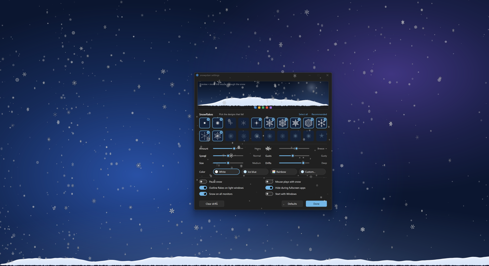
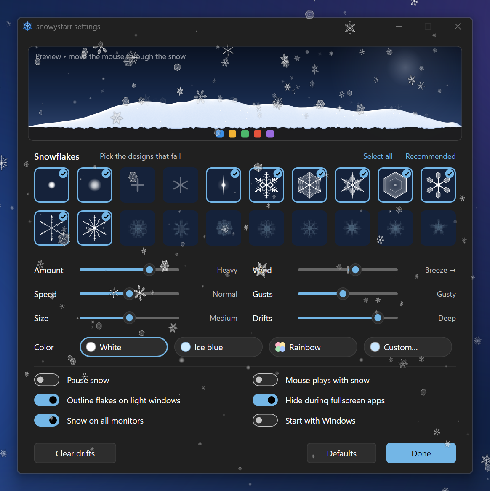

# snowystarr

Snow for your Windows desktop. Flakes drift across every monitor, sway in gusty
wind, and gently pile up in haphazard drifts along the top of the taskbar. You can
sweep the snow around with your mouse.



snowystarr is a small native Windows 10/11 app written in C++ with Direct2D and
DirectComposition. It is a single ~0.6 MB `.exe` that lives in the notification
area, and clicks pass straight through the snow to whatever is underneath.

## Snow drifts

Flakes that reach the taskbar settle into soft, rounded drifts: they build up,
slump when too steep, get sculpted by the wind, and slowly melt, so the pile keeps
changing shape. A little lip of snow hangs over the edge of the taskbar.


## Settings

Click the snowflake in the notification area to open the settings. The live preview
at the top shows your choices immediately, and you can play with the snow there
using the mouse.



- **20 flake designs**, each switched on or off individually:
  - powder, soft bokeh flakes, crosses, asterisks and twinkling sparkles;
  - seven kinds of ice crystal: dendrites, sectored plates, ferns, hexagonal plates, stellar plates, needles and twelve-branched stars;
  - eight classic pixel-art flakes.
- **Amount, speed, size, wind, gusts and drift depth** sliders.
- **Color**: white, ice blue, pastel rainbow, or any custom color.
- **Switches**:
  - pause;
  - mouse play;
  - outlines that keep flakes visible over white windows;
  - hide during fullscreen apps;
  - snow on all monitors;
  - start with Windows.

Right-click the snowflake for a quick menu with presets for everything above.

> Screenshots: snowystarr running on Windows 11 at 150% scaling, over a plain backdrop.

## Features

- **Every monitor**: each display gets its own overlay at its own resolution, DPI and refresh rate. A 60 Hz screen next to a 144 Hz one stays smooth.
- **Fluid animation**:
  - GPU rendering paced to each display's vertical blank;
  - depth (parallax, size and opacity);
  - flutter and tumbling plates;
  - turbulent wind whose gusts sweep across the desktop.
- **Stays out of the way**:
  - clicks pass through;
  - it hides during fullscreen games and videos, on the lock screen, under the screen saver and while the display is off;
  - it doesn't make Windows think a fullscreen app is running.
- **Light on power**:
  - about 0.3 ms of CPU per frame;
  - capped at 60 fps on battery and 30 fps with battery saver or over Remote Desktop.

## Install

Download `snowystarr-<version>-setup.exe` from the
[latest release](https://github.com/starrlord/snowystarr/releases/latest) and run it.

- It installs for the current user without admin rights. An "install for all users" option is still available.
- It can start snowystarr when you sign in.
- It adds a Start menu entry and uninstalls cleanly from *Settings → Apps*.

There is also a portable zip containing just `snowystarr.exe`.

The installer is not code-signed yet, so Windows SmartScreen may warn on first run.
Choose *More info → Run anyway*.

Requires Windows 10 (1809 or later) or Windows 11, x64.

## Build from source

Requirements:
- Visual Studio 2022 with *Desktop development with C++*, or the Build Tools;
- the Windows 10/11 SDK;
- CMake 3.20+;
- for the installer, [Inno Setup 6](https://jrsoftware.org/isinfo.php) (`winget install JRSoftware.InnoSetup`).

```powershell
.\build.ps1                          # build\Release\snowystarr.exe
.\build.ps1 -Installer               # ...plus dist\snowystarr-<version>-setup.exe
.\build.ps1 -Version 1.2.0 -Installer
```

`tools/make_icon.py` regenerates the icons in `res/`; it needs Python with NumPy.
For frame-timing diagnostics, set `SNOWYSTARR_DEBUG=1` before starting. Each monitor
then logs its frame pacing to `%TEMP%\snowystarr.log`.

## Releasing

GitHub Actions (`.github/workflows/build.yml`) builds the app and the installer on
every push and pull request, and uploads them as workflow artifacts. To publish a
release, push a version tag:

```powershell
git tag v1.0.0
git push origin v1.0.0
```

The workflow stamps that version into the exe and the installer, then creates a
GitHub release with the setup exe and a portable zip.

## How it works

- **`App`** (UI thread):
  - the tray icon and menu;
  - one click-through DirectComposition overlay per monitor;
  - taskbar geometry, and keeping the overlays above the taskbar;
  - fullscreen, lock and power handling.
- **`MonitorRenderer`** (one thread per monitor):
  - a composition swap chain on a shared Direct3D 11 / Direct2D device;
  - paced by the swap chain's waitable object, or by the monitor's own vblank when its refresh rate differs from the primary's.
- **`Scene`**:
  - the flakes and the air flow (curl-noise turbulence plus traveling gusts);
  - landing, mouse play, powder puffs and glints;
  - drawing with Direct2D sprite batches.
- **`Drift`**:
  - the snow pile, a 1-pixel heightfield with deposition, angle-of-repose avalanching, cohesive rounding, wind transport and melt;
  - shaded on the CPU into a strip drawn over the taskbar edge.
- **`FlakeArt`**: procedural vector flake designs and a multi-resolution sprite atlas.
- **`SettingsWindow`**: a small immediate-mode Direct2D UI with a live preview.
